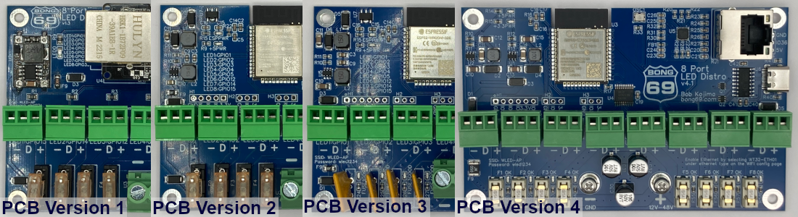

# 8 Port LED Distro Board Versions
[Back to the README](./README.md) · [Network setup](./NETWORK.md) · [FAQ](./FAQ.md) · [Troubleshooting](./TROUBLESHOOTING.md)

| Version | Pixel voltage | Fuses | Status |
| --- | --- | --- | --- |
| 4 | 12 V to 48 V | 5 A replaceable (1808, in fuse holders) | Made now |
| 3 | 5 V, 12 V and 24 V | Resettable, 4 A hold / 8 A trip | No longer made |
| 2 | 5 V, 12 V and 24 V | | No longer made |
| 1 | 5 V, 12 V and 24 V | | No longer made |

## What's new in Version 4?
- Works with input voltages from 12 V to 48 V, including 36 V pixels like Govee and 48 V pixels like JellyFish.
- No longer supports 5 V pixels.
- 5 A replaceable fuses on the LED power outputs.
- Power input on round nuts for spade connectors.
- New step-down converters make the 3.3 V and 5 V the board needs.
- The through-hole input capacitor was replaced with 3 SMD capacitors.
- Dimmer blue fuse indicator lights.

## What's new in Version 3?
- Resettable fuses on the LED power outputs, with 4 A hold / 8 A trip.
- A blue light next to each fuse that's on while the fuse is good, so you can tell if a fuse has tripped.
- A 33 Ω resistor on each data output (was 100 Ω).
- MOSFETs on GPIO 1 and 3. These pins are shared by LED data and the USB-C port.
- All the power indicator lights are green now (one was blue before).
- GPIO 39 was added to the H1 header.

## What's new in Version 2?
- All the parts of the WT32-ETH01 moved onto the main board.
- A new step-up/down converter turns 5 V, 12 V or 24 V into the 5 V the level shifters need.
- A better circuit for the 3.3 V the ESP32 and the Ethernet port need.
- The H1 header now has 3 GPIO pins, so a digital microphone like the INMP441 can connect.
- Headers H2, H3 and H4 are inputs, for buttons and temperature sensors.
- Doubled positive traces for the fuses and Phoenix connectors, with 1 oz copper on both the top and bottom of the board.
- The Ethernet jack faces up, away from the board, so you can mount the board against something and still plug in Ethernet.
- The LED ports were moved to GPIO pins that are easier to remember.

## Dimensions
- Version 1: 110 mm × 70 mm × 30 mm
- Version 2, 3 and 4: 110 mm × 70 mm × 25 mm

## GPIO pins for each port
| Port | Version 1 | Version 2, 3, 4 |
| ---- | ------ | -------------- |
| LED1 | GPIO15 | GPIO1 |
| LED2 | GPIO14 | GPIO2 |
| LED3 | GPIO12 | GPIO3 |
| LED4 | GPIO4 | GPIO4 |
| LED5 | GPIO2 | GPIO5 |
| LED6 | GPIO17 | GPIO12 |
| LED7 | GPIO5 | GPIO14 |
| LED8 | GPIO33 | GPIO15 |

## Every GPIO pin
| Pin | Version 1 | Version 2, 3, 4 |
| ------ | -- | -- |
| GPIO00 | EN | EN |
| GPIO01 | USB-RX | LED1 / USB-RX |
| GPIO02 | LED5 | LED2 |
| GPIO03 | USB-TX | LED3 / USB-TX |
| GPIO04 | LED4 | LED4 |
| GPIO05 | LED7 | LED5 |
| GPIO12 | LED3 | LED6 |
| GPIO13 | RMII EMAC RXER | RMII EMAC RXER |
| GPIO14 | LED2 | LED7 |
| GPIO15 | LED1 | LED8 |
| GPIO16 | OSC EN | OSC EN |
| GPIO17 | LED6 | H1 |
| GPIO18 | RMII MDIO | RMII MDIO |
| GPIO19 | RMII EMAC TXD0 | RMII EMAC TXD0 |
| GPIO21 | RMII EMAC TXEN | RMII EMAC TXEN |
| GPIO22 | RMII EMAC TXD1 | RMII EMAC TXD1 |
| GPIO23 | RMII MDC | RMII MDC |
| GPIO25 | RMII EMAC RXD0 | RMII EMAC RXD0 |
| GPIO26 | RMII EMAC RXD1 | RMII EMAC RXD1 |
| GPIO27 | RMII EMAC CRS DV | RMII EMAC CRS DV |
| GPIO32 | H1 | H1 |
| GPIO33 | LED8 | H1 |
| GPIO34 | open | H2 |
| GPIO35 | H6 | H3 |
| GPIO36 | H7 | H4 |
| GPIO39 | open | open (H1 on Version 3 and 4) |
