# 8 Port LED Distro FAQ
[Back to the README](./README.md) · [Network setup](./NETWORK.md) · [Troubleshooting](./TROUBLESHOOTING.md) · [Board versions](./BOARD_VERSIONS.md)

**Power and wiring**
- [What power supply do I need?](#what-power-supply-do-i-need)
- [Can I use different pixel voltages on different ports?](#can-i-use-different-pixel-voltages-on-different-ports)
- [Can the USB-C port power the board?](#can-the-usb-c-port-power-the-board)
- [Should I put a fuse on the power supply feed?](#should-i-put-a-fuse-on-the-power-supply-feed)
- [What fuses does it use?](#what-fuses-does-it-use)
- [How do I do power injection?](#how-do-i-do-power-injection)
- [How long can the data cable to the first pixel be?](#how-long-can-the-data-cable-to-the-first-pixel-be)

**Ports and pixels**
- [How many pixels can each port run?](#how-many-pixels-can-each-port-run)
- [What are the GPIO pins for each port?](#what-are-the-gpio-pins-for-each-port)
- [How do I set the LED preferences for each port?](#how-do-i-set-the-led-preferences-for-each-port)
- [How do I set up the brightness limiter?](#how-do-i-set-up-the-brightness-limiter)

**xLights and other firmware**
- [How do I add the 8 Port LED Distro to xLights?](#how-do-i-add-the-8-port-led-distro-to-xlights)
- [How do I install ESPixelStick?](#how-do-i-install-espixelstick)
- [Can I control DMX lights?](#can-i-control-dmx-lights-with-the-8-port-led-distro)

**Firmware and setup files**
- [How do I update the firmware?](#how-do-i-update-the-firmware)
- [How do I upgrade from WLED 0.14 to 0.15?](#how-do-i-upgrade-from-wled-014-to-015)
- [Can I get the config file the board ships with?](#can-i-get-the-config-file-the-board-ships-with)
- [How do I compile WLED for this board?](#how-do-i-compile-wled-for-this-board)
- [Where can I find the driver for the USB-C port?](#where-can-i-find-the-driver-for-the-usb-c-port)

**Add-ons**
- [How do I use sound reactive WLED?](#how-do-i-use-sound-reactive-wled)
- [How do I add a DS18B20 temperature sensor?](#how-do-i-add-a-ds18b20-temperature-sensor)
- [How do I hook up a relay?](#how-do-i-hook-up-a-relay)
- [Can a relay turn the board on and off?](#can-a-relay-turn-the-board-on-and-off)

**Mounting and the board**
- [What are the dimensions and mounting holes?](#what-are-the-dimensions-and-mounting-holes)
- [Where can I get the STL files for mounts?](#where-can-i-get-the-stl-files-for-mounts)
- [What temperatures can it run in?](#what-temperatures-can-it-run-in)
- [How do you test the boards before shipping?](#how-do-you-test-the-boards-before-shipping)
- [Where can I get the Gerber files?](#where-can-i-get-the-gerber-files)

---

# Power and wiring

## What power supply do I need?
- **Voltage**: the same as your pixels. 12 V pixels need a 12 V supply, 36 V pixels a 36 V supply, and so on. The board runs from 12 V to 48 V.
- **Size**: add up the full-brightness power of all your pixels, then pick a supply about 20% to 30% bigger so it doesn't run flat out. Your pixel seller usually lists watts per pixel or per meter.

For example, three runs of 90 pixels of 36 V Govee-style pixels come to about 160 W at full white, which is about 4.5 A at 36 V. A Mean Well LRS-350-36 (36 V, 9.7 A), which we use for testing, handles that with plenty to spare.

Use one power supply for the board and all its pixels, including any power injection. See [How do I do power injection?](#how-do-i-do-power-injection)

## Can I use different pixel voltages on different ports?
No. The board has one power input, and every port gets the same voltage as that input. Use a separate board for pixels with a different voltage.

## Can the USB-C port power the board?
No. The USB-C port is only for loading firmware. When you plug in USB-C, the board goes into bootloader mode, and WLED doesn't run in bootloader mode. Power the board from the main power input.

## Should I put a fuse on the power supply feed?
It's a good idea. The fuses on the board protect each output and the board's own circuits, but not the wire from your power supply to the board. Most good power supplies shut down on a short, but a fuse or breaker next to the supply protects that wire too. Size it for the wire you use and no bigger than your supply. The power input is rated for 40 A and has reverse-polarity protection.

## What fuses does it use?
Version 4 uses **1808 size, 5 A, fast-acting** surface-mount fuses. They sit in fuse holders, so you can swap them by hand with no soldering. The light next to each fuse is on while the fuse is good. Use 5 A fuses only. If a port needs more than 5 A, split the string across 2 ports or use power injection.

We don't sell spares, but you can find them on [Amazon](https://www.amazon.com/MECCANIXITY-Surface-Mount-Device-Acting/dp/B0GXK17C7F). That listing has several current ratings, so make sure you choose **5 A**.

Version 3 used resettable fuses (4 A hold, 8 A trip). They reset on their own after they cool down.

## How do I do power injection?
I try to avoid power injection. When a string gets too long, I split it and use 2 ports. If you do need it:

1. Use **one big power supply** for both the 8 Port LED Distro and a [fuse block like this](https://www.amazon.com/dp/B07GBV2MHN). The board and the fuse block must be on the same power supply. Two power supplies cause problems.
2. Connect power and data from the 8 Port LED Distro to the start of the first strip in the string.
3. Connect power from the fuse block to the start of the second strip, the third strip, and so on.
4. You may need to inject power more often if your LEDs are dense.

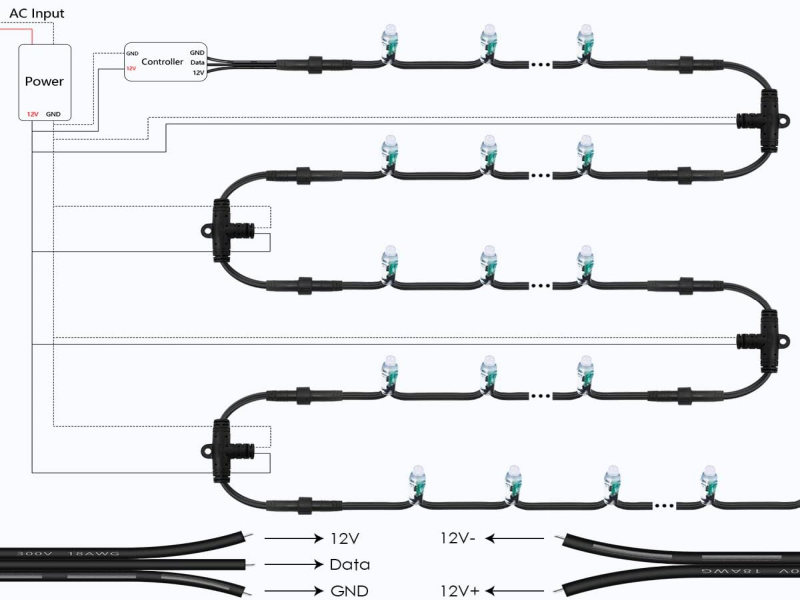

This [power injection video](https://youtu.be/cD4_sTPjlPw?si=P7iIm6Ki0dh9d2vj) explains 3 ways to do it.

## How long can the data cable to the first pixel be?
Several runs in our own display have 30 ft of cable from the port to the first pixel, and they work without a data booster. The data outputs are 5 V, from 74AHCT245 level shifters, with a 33 Ω resistor on each output (since Version 3). Before we changed to 33 Ω resistors, we needed F-amps on some runs. Now we don't use them at all.

Tips for long runs:
- Run the ground wire alongside the data wire. A twisted pair for data and ground is even better.
- If you do see flicker, see [I see random flickering](./TROUBLESHOOTING.md#i-see-random-flickering-on-some-of-my-led-strings).

---

# Ports and pixels

## How many pixels can each port run?
The limit is how long it takes to send the data. Each port sends its pixels one after another, so more pixels per port means fewer frames per second.

WLED doesn't publish hard limits. We usually run **300 RGB pixels per port**, and we've tested up to 600 ([4800 pixels on one board](https://www.youtube.com/watch?v=fwenCKE-0Dk)).

Pixels that send more data per pixel take longer, so fewer fit on a port in the same time:

| Pixel type | Suggested per port | Same timing as our 600 test |
| --- | --- | --- |
| WS2811, WS2812, WS2815 (RGB) | 300 | 600 |
| SK6812 (RGBW) | 225 | 450 |
| SM16825 (RGBCCT, 16-bit) | 90 | 180 |

The RGBW and SM16825 numbers are worked out from how much data each pixel takes. We haven't tested them on the board. If you need more pixels on a string, split it across 2 ports. WLED also limits the total pixels on one ESP32, so check the [WLED docs](https://kno.wled.ge/) before you plan a very big show.

## What are the GPIO pins for each port?
The same on Version 2, 3 and 4. Port 1 is the output on the left, next to fuse F1, and Port 8 is on the right, next to F8.

| Port | GPIO |
| ---- | ---- |
| LED1 | 1 |
| LED2 | 2 |
| LED3 | 3 |
| LED4 | 4 |
| LED5 | 5 |
| LED6 | 12 |
| LED7 | 14 |
| LED8 | 15 |

Version 1 used different pins. See [Board versions](./BOARD_VERSIONS.md) for Version 1 and for the full list of every pin.

## How do I set the LED preferences for each port?
1. Press **Config** at the top right of the screen, then **LED Preferences**.
2. Scroll down to **LED outputs**.

   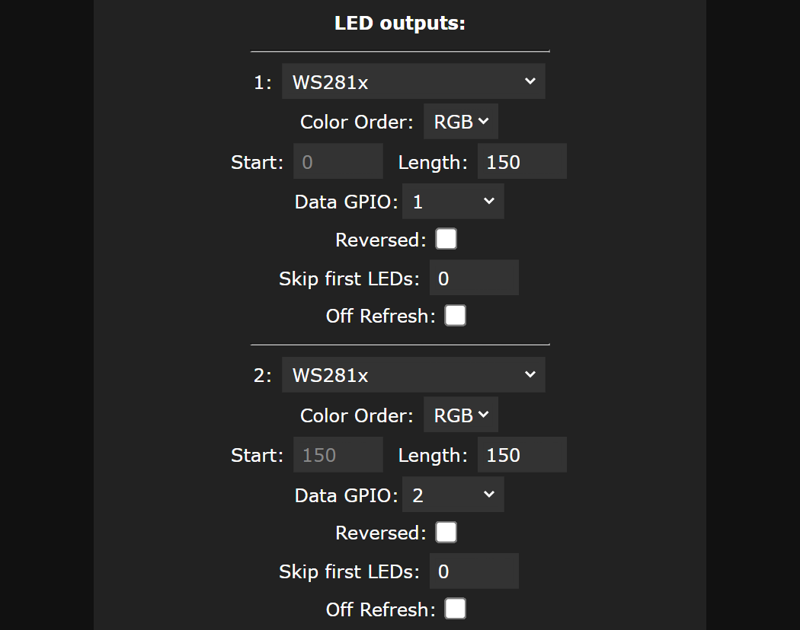

3. Next to **1:**, use the drop-down to pick the type of LED strip you have.
4. Set the **Color Order**. Strips don't all use the same order, so if the colors you pick don't look right, change it.
5. Set the **Length**: the number of LEDs on that port.
6. Set the **Data GPIO**. See [What are the GPIO pins for each port?](#what-are-the-gpio-pins-for-each-port) For LED1 it's 1.
7. Press **+** to add the next port, and repeat steps 3 to 6.
8. Press **Save** when you're done.

If WLED won't let you pick a GPIO, see [WLED won't let me set a GPIO](./TROUBLESHOOTING.md#wled-wont-let-me-assign-a-gpio-to-a-port).

## How do I set up the brightness limiter?
The brightness limiter turns the brightness down automatically when your lights would draw more current than you allow. It keeps your power supply and the 5 A fuses from being overloaded when everything goes full white. We recommend turning it on.

It also works while xLights is sending data. WLED doesn't measure current. It works it out from how bright each LED is set, so it needs to know how much one LED draws. The steps below use the setting names in current WLED. Older versions may name them a little differently.

1. **Find out how much one pixel draws.** Turn on 50 pixels with every color at full (white, plus the white channels on RGBW or RGBCCT pixels). Read the current with a meter or clamp meter, and divide by 50. Your pixel seller may also list it.
2. Go to **Config** → **LED Preferences** and tick **Enable automatic brightness limiter**.
3. Tick **Use per-output limiter**. WLED recommends this when you use more than one output.
4. For each output:
   - **mA/LED**: choose **Custom**, then enter the current per pixel from step 1 in **max. mA/LED**. **30mA (typ. 12V)** and **12mA (WS2815)** are there if they match your pixels.
   - **PSU**: the most current that output may draw, in mA. Set it to **4500** or less so the port can't blow its 5 A fuse, and make sure all 8 outputs together don't add up to more than your power supply. With one supply, share its current between the outputs.
5. Press **Save**.
6. Turn everything on full white and check with your meter that the current stays under your limits.

The limiter works out the current at the same voltage as your pixels, so it works the same for 12 V, 24 V, 36 V and 48 V pixels: enter the pixel current and the power supply's amps as they are. The limit is only an estimate, so leave some headroom.

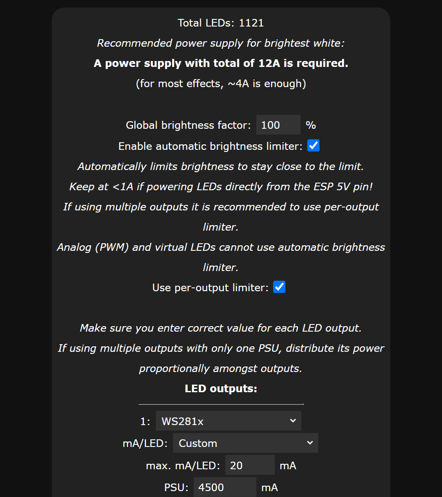

In this example, output 1 is set to 20 mA per pixel and 4500 mA at most.

---

# xLights and other firmware

## How do I add the 8 Port LED Distro to xLights?
1. On the **Controllers** tab, press **Add Ethernet**.

   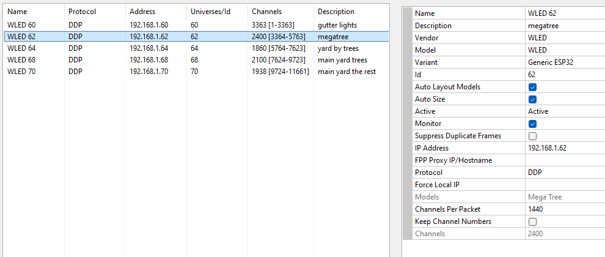

2. Enter the IP address of the 8 Port LED Distro.
3. Give it a name and description.
4. **Vendor**: WLED. **Model**: WLED. **Variant**: Generic ESP32.
5. Give it an ID number. I usually use the last number of the IP address.
6. **Protocol**: DDP.
7. Untick **Keep Channel Numbers**.
8. Press **Visualise** (bottom middle of the screen) and drag your models onto the ports.

   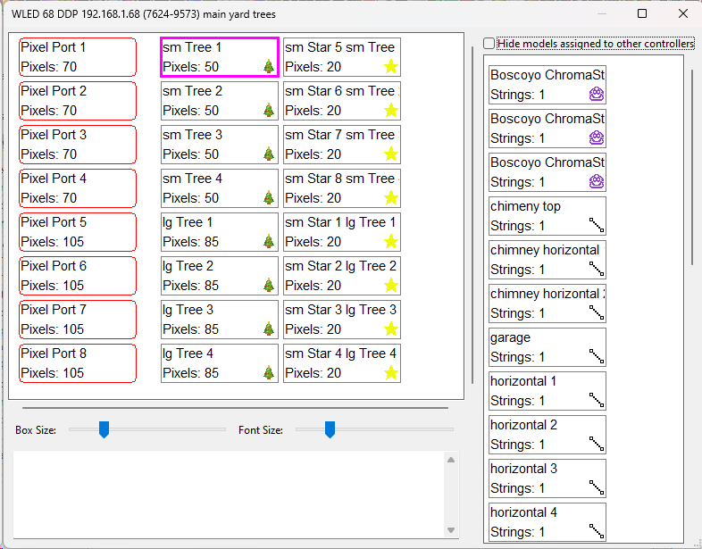

9. Close the window and press **Save** (top left).

Give the board a static IP address and connect it with Ethernet first, so xLights can always find it. See [Network setup](./NETWORK.md).

## How do I install ESPixelStick?
1. Download and unzip the latest **dist.zip** release of ESPixelStick: [dist.zip on GitHub](https://github.com/MartinMueller2003/ESPixelStick/releases/tag/dist)
2. Connect the 8 Port LED Distro to your computer with a USB-C cable.
3. Run **ESPSFlashTool.jar**. You need Java 8 installed.
4. **Hardware**: ESP32 BONG 69.
5. **Serial Port**: the COM port that says USB-SERIAL CH340.
6. Fill in the **SSID** and **Passphrase** of your home Wi-Fi.
7. Fill in the **IP Address**, **Subnet Mask** and **Gateway**, so the ESPixelStick setup page is easy to find.

   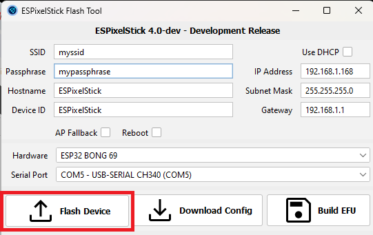

8. Press **Flash Device** and wait for it to finish.
9. Unplug the USB-C cable and power the board from the main power input.
10. Go to the IP address you set in a browser to finish setting up ESPixelStick.

## Can I control DMX lights with the 8 Port LED Distro?
Yes, with ESPixelStick firmware and a DMX adapter. The [DMX Adapter page](https://github.com/bobko69/DMX_Adapter) shows how to make the adapter and set it up.

---

# Firmware and setup files

## How do I update the firmware?
There are three ways. None of them use the Arduino IDE.

- **From your browser (easiest):** connect the board to a computer with a USB-C cable and go to [install.wled.me](https://install.wled.me/) in Chrome or Edge. Pick the firmware version and click the **Ethernet** button. Press **Install** and follow the prompts. When it's done, it asks you to set up Wi-Fi. **Skip this** if you'll use Ethernet or the WLED-AP.
- **Over the network:** if you've downloaded or built a firmware file and the board is on your Wi-Fi or Ethernet, open the board's WLED page. Go to **Config** → **Security & Updates** → **Manual OTA Update**, choose the file and press **Update WLED!**

  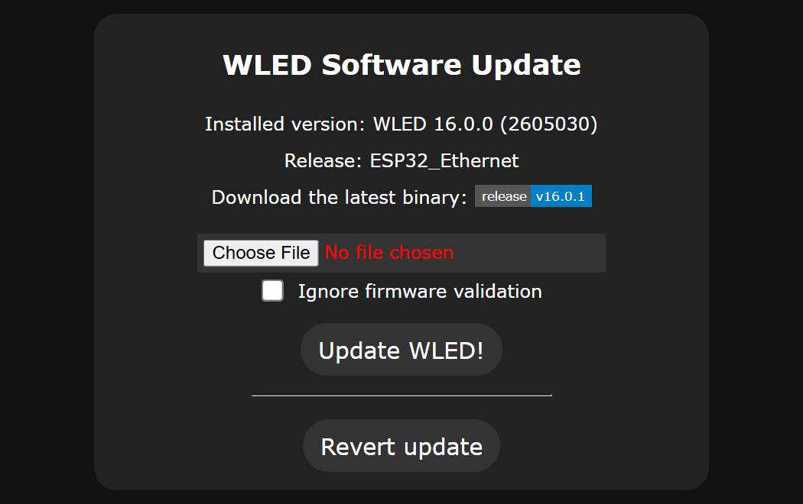

- **With esptool:** connect the board with USB-C and use [esptool](https://github.com/espressif/esptool), a command-line tool. This is the command we use to load firmware onto the boards:
  ```
  esptool write_flash 0x10000 WLED_0.15.3_ESP32_Ethernet.bin
  ```

## How do I upgrade from WLED 0.14 to 0.15?
The WLED 0.14 config file doesn't work with 0.15, so you need to erase the whole flash when you upgrade:

1. Connect the board to a computer with a USB-C cable and open [install.wled.me](https://install.wled.me/).

   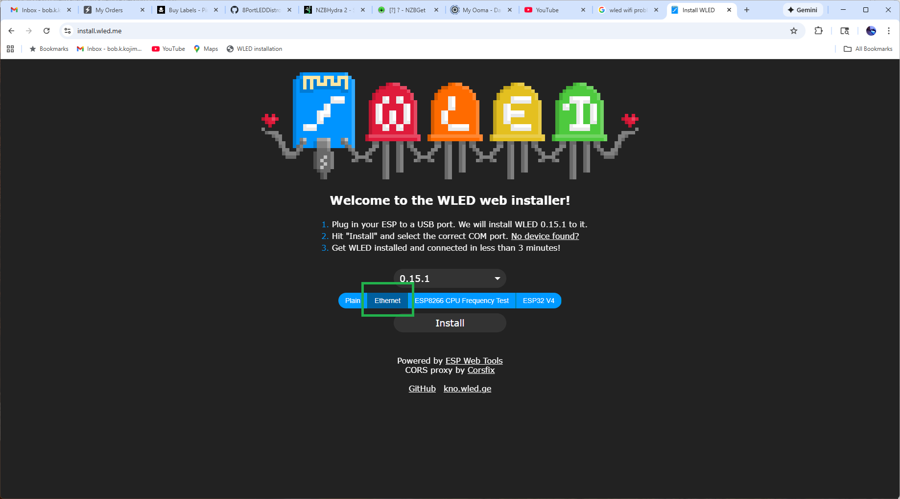

2. Click the blue **Ethernet** button, then **Install**.

   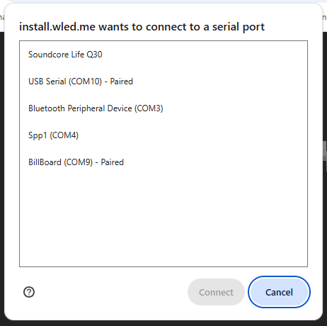

3. Pick the COM port the board is connected to.

   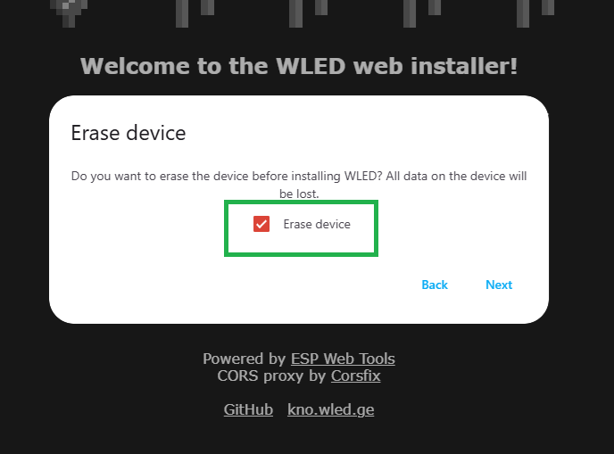

4. When asked, tick **Erase Device**.
5. When it asks you to set up Wi-Fi, skip it.
6. Unplug the USB-C cable and power the board from the main power input.
7. Join the WLED-AP with your phone and set up Wi-Fi there.
8. Set up the output ports again. See [How do I set the LED preferences for each port?](#how-do-i-set-the-led-preferences-for-each-port)

In 0.15, GPIO 14 and 15 are taken by the sound reactive microphone by default. See [WLED won't let me assign a GPIO](./TROUBLESHOOTING.md#wled-wont-let-me-assign-a-gpio-to-a-port) to free them for ports 7 and 8.

## Can I get the config file the board ships with?
These are the config files we load before we ship a board:
- [WLED 0.14 config file](https://github.com/bobko69/8PortLEDDistro/blob/main/files/wled_cfg_SHIP_0.14.x.json)
- [WLED 0.15 config file](https://github.com/bobko69/8PortLEDDistro/blob/main/files/wled_cfg_SHIP_0.15.x.json)

## How do I compile WLED for this board?
1. Follow WLED's [compiling guide](https://kno.wled.ge/advanced/compiling-wled/) for PlatformIO.
2. Open `platformio.ini`.
3. Make sure `esp32_eth` is uncommented as `default_envs`.
4. Build and upload to the board.

## Where can I find the driver for the USB-C port?
The USB-C port uses a CH340 chip. Windows and Mac drivers are here: [CH340 driver](https://learn.sparkfun.com/tutorials/how-to-install-ch340-drivers/all)

---

# Add-ons

## How do I use sound reactive WLED?
You need an INMP441 microphone and a 6 pin female header soldered to **H1** on the board. This works on Version 3 and 4.

1. Wire up the microphone:

   | 8 Port LED Distro | INMP441 |
   | ------- | ----------------- |
   | GND | GND and L/R |
   | GPIO39 | nothing |
   | GPIO32 | WS |
   | GPIO33 | SCK |
   | 3.3 V | VDD |
   | GPIO17 | SD |

   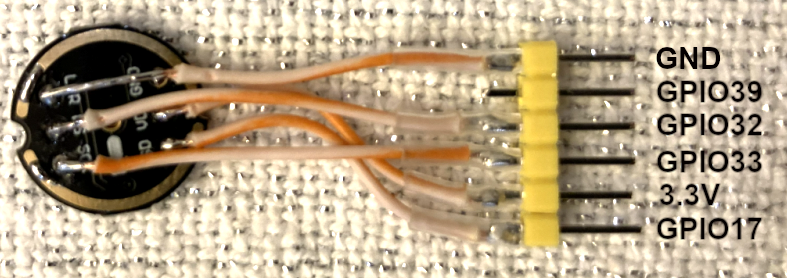

2. In WLED, go to **Config** → **Usermods** and scroll down to **AudioReactive**.
3. Tick **Enabled** and set:
   - **Type** (under Digitalmic): Generic I2S
   - **Pin I2S SD**: 17
   - **Pin I2S WS**: 32
   - **Pin I2S SCK**: 33
   - **Squelch**: 10
   - **Gain**: 30
4. Press **Save** and restart the board.

   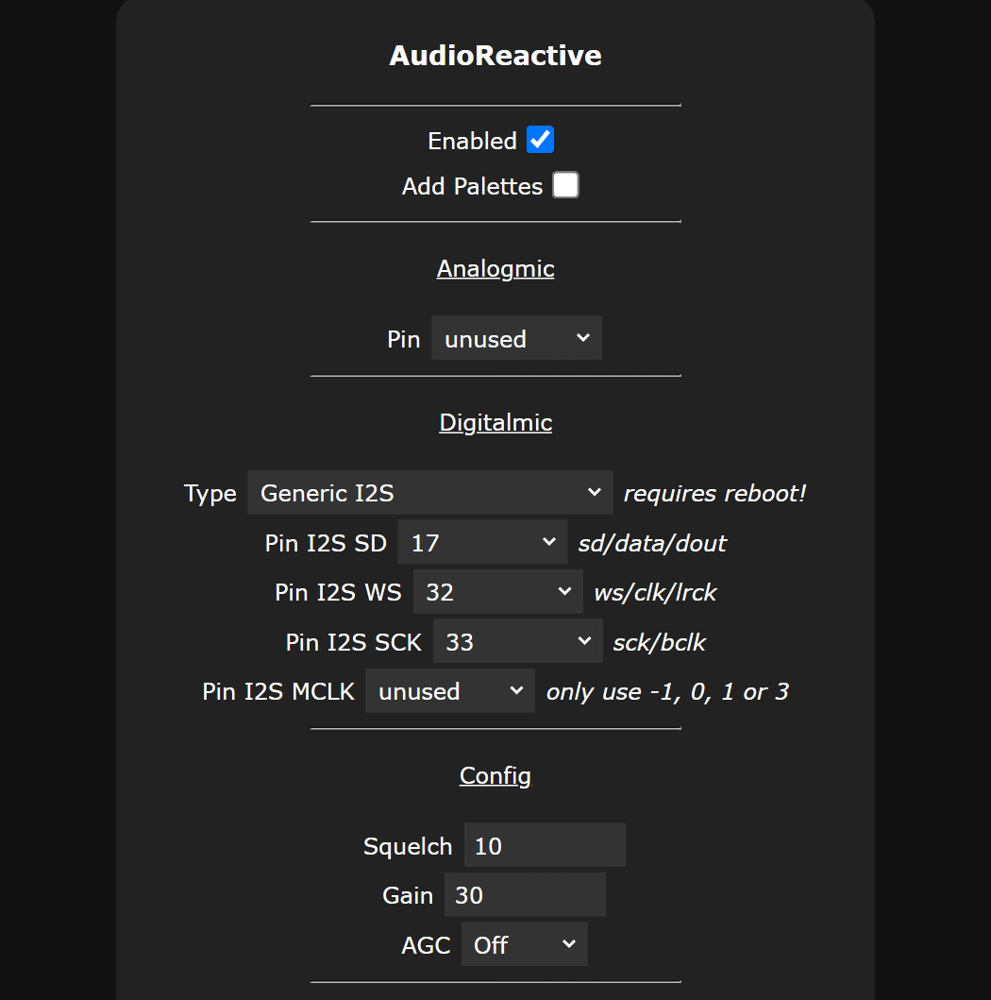

The microphone uses GPIO 32 and 33, the same pins as the temperature sensor and the relay. You can use only one of them at a time.

## How do I add a DS18B20 temperature sensor?
1. Install this firmware, which has Ethernet and the temperature sensor built in: [WLED_0.15.3_ESP32_Ethernet_tempsensor.bin](https://github.com/bobko69/8PortLEDDistro/blob/main/files/WLED_0.15.3_ESP32_Ethernet_tempsensor.bin)
2. Under **Config** → **Usermods**, check that the temperature sensor's GPIO pin is set to **33**.

   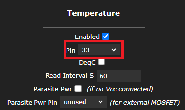

3. Solder a 5 pin female header to **H1**.

   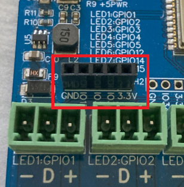

4. Take a 5 pin male header and remove pins 2 and 3.

   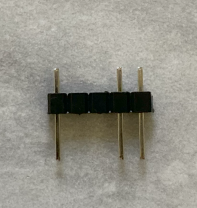

5. Solder on the DS18B20 (flat side up) and a 4.7 kΩ resistor as in this photo:

   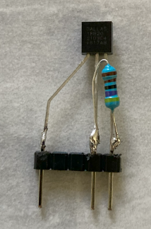

6. Turn off the power, plug the sensor into the header on H1, and turn the power back on.

   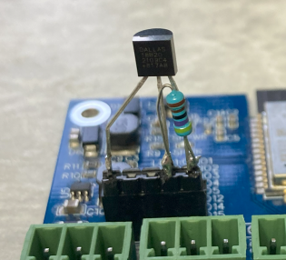

7. The temperature now shows on the **Info** tab.

   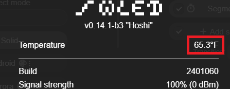

## How do I hook up a relay?
Use **IO32** on header **H1** as the output to the relay. Header **H4** (behind the Ethernet jack) has 5 V and GND. Follow this [ESP32 relay tutorial](https://esp32io.com/tutorials/esp32-relay) and connect 5 V to DC+, GND to DC- and IO32 to IN. Then set **Relay GPIO** to 32 in WLED (Config → LED Preferences).

## Can a relay turn the board on and off?
No. The board has only one power input. If a relay turns the power off, the ESP32 turns off too, and then there's nothing to tell the relay to turn the board back on.

I use [Kasa smart plugs](https://www.amazon.com/Kasa-Smart-Required-Certified-EP10P4/dp/B091FXLMS8) to turn my controllers on and off. They need much less wiring and have a nice app for scheduling. Mine turn on at dusk and off at 11 pm every night.

---

# Mounting and the board

## What are the dimensions and mounting holes?
- **Board**: 110 mm × 70 mm × 25 mm (Version 2, 3 and 4). Version 1 is 30 mm tall.
- **Mounting holes**: 3 mm. The spacing from outside edge to outside edge is 105 mm × 65 mm.

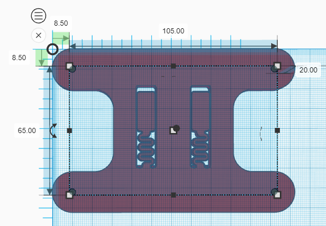

## Where can I get the STL files for mounts?
These mounts are free on Printables:
- [CG1500 enclosure and DIN rail mount](https://www.printables.com/model/1873132-8-port-led-distro-cg1500-mount)

  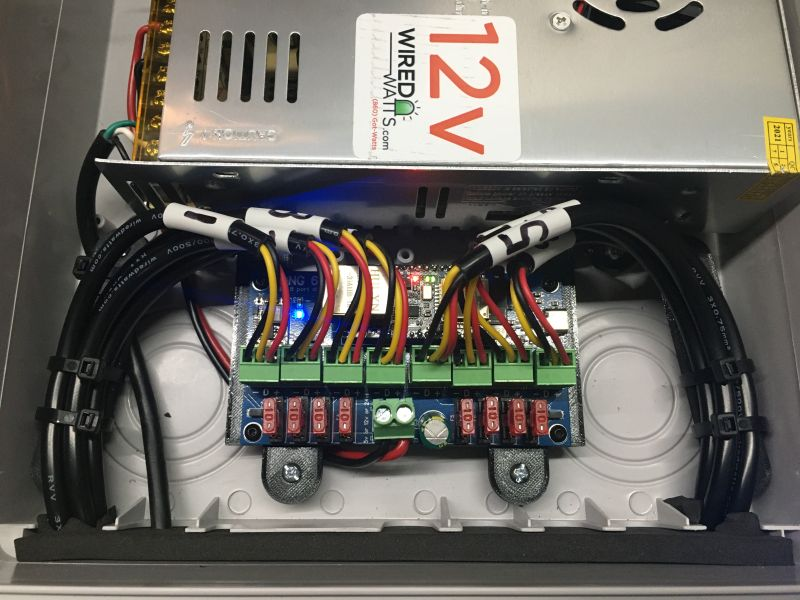

- [MTM AC30C-11 case mount](https://www.printables.com/model/1873141-8-port-led-distro-mtm-ac30c-11-mount), with instructions

  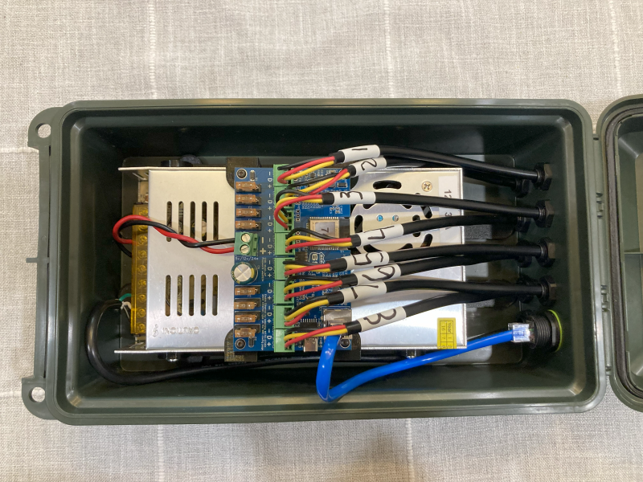

For more installs, see the "Built for real installs" section on [bong69.com](https://bong69.com).

## What temperatures can it run in?
We haven't done formal temperature testing, so we can't give a rated range. Our own boards run outdoors in cold weather without problems. For outdoor installs, mount the board in a weatherproof box, like the cases above.

## How do you test the boards before shipping?
1. We load the WLED firmware over USB-C, which tests the USB port. At the same time we load a test config with 150 LEDs on each of the 8 ports, an IP address and Ethernet turned on.
2. Our test fixture connects to the board over Ethernet and runs effects on all 8 ports, which tests the Ethernet port and every output.
3. We load the config file the boards ship with.
4. Last, we unplug the Ethernet cable, restart the board, connect over Wi-Fi and check that everything still works. This tests the Wi-Fi.

<a href="https://www.youtube.com/watch?v=qrvC3uFBEQM" target="_blank"></a>

## Where can I get the Gerber files?
Sorry, they aren't available. This isn't an open-source project.
