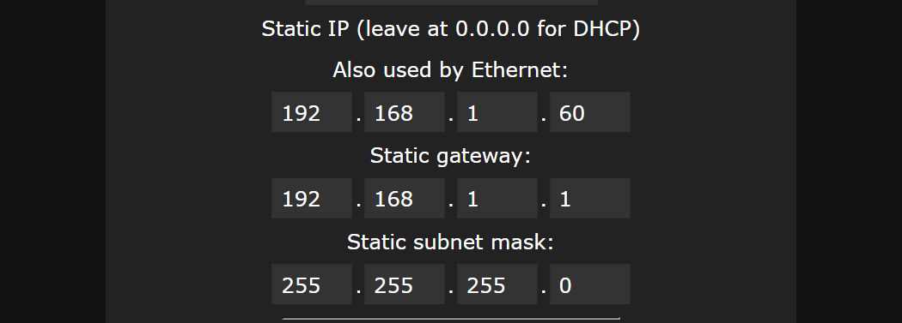

# 8 Port LED Distro Network Setup
[Back to the README](./README.md) · [FAQ](./FAQ.md) · [Troubleshooting](./TROUBLESHOOTING.md) · [Board versions](./BOARD_VERSIONS.md)

The board can connect three ways:
- **WLED-AP**: the board makes its own Wi-Fi network, and you join it with your phone. This is how every board starts. Good for trying it out, but your phone can't use the internet while it's joined.
- **Your home Wi-Fi**: the board joins your Wi-Fi like any other device. Good for running WLED effects from your phone or the WLED app.
- **Ethernet**: a cable from the board to your router or switch. Best for xLights shows, because a cable doesn't drop data the way Wi-Fi can.

**Setting up**
- [Should I use Wi-Fi or Ethernet?](#should-i-use-wi-fi-or-ethernet)
- [How do I connect the board to my home Wi-Fi?](#how-do-i-connect-the-board-to-my-home-wi-fi)
- [How do I set up Ethernet?](#how-do-i-set-up-ethernet)
- [How do I pick a static IP address?](#how-do-i-pick-a-static-ip-address)
- [How do I find the board's IP address?](#how-do-i-find-the-boards-ip-address)
- [Can I use Wi-Fi and Ethernet at the same time?](#can-i-use-wi-fi-and-ethernet-at-the-same-time)
- [I have more than one board](#i-have-more-than-one-board)
- [Can I connect the board straight to my computer?](#can-i-connect-the-board-straight-to-my-computer)

**Problems**
- [The board won't join my Wi-Fi](#the-board-wont-join-my-wi-fi)
- [I no longer see the WLED-AP](#i-no-longer-see-the-wled-ap)
- [I can't find the board on my network](#i-cant-find-the-board-on-my-network)
- [Ethernet doesn't work](#ethernet-doesnt-work)
- [xLights over Wi-Fi is choppy](#xlights-over-wi-fi-is-choppy)
- [I've tried everything and can't reach the board](#ive-tried-everything-and-cant-reach-the-board)

---

# Setting up

## Should I use Wi-Fi or Ethernet?
- **Running WLED effects and presets** from your phone: Wi-Fi is fine.
- **Running an xLights show**: use Ethernet. xLights sends a lot of data, 40 times a second or more, and Wi-Fi can drop some of it, which shows up as stutter or flicker.
- **The board is in a metal box, or far from your router**: use Ethernet. Wi-Fi signals don't get through metal well.

## How do I connect the board to my home Wi-Fi?
The board only works with **2.4 GHz** Wi-Fi. Most home routers have 2.4 GHz, often under the same name as 5 GHz. See [The board won't join my Wi-Fi](#the-board-wont-join-my-wi-fi) if it doesn't connect.

1. On your phone, join the **WLED-AP** network (password **wled1234**).
2. In the page that opens, go to **Config** → **WiFi Setup**.
3. Under **Network name (SSID)**, enter your Wi-Fi name, or press **Scan** and pick it. Enter your Wi-Fi password under **Network password**. Both are case-sensitive.
4. We recommend a static IP address, so the board is always at the same address. See [How do I pick a static IP address?](#how-do-i-pick-a-static-ip-address) Or leave it at 0.0.0.0 and your router will give the board an address.
5. Press **Save & Connect**.
6. The board joins your Wi-Fi and the WLED-AP network goes away. Switch your phone back to your home Wi-Fi, then open the board's page at its IP address. See [How do I find the board's IP address?](#how-do-i-find-the-boards-ip-address)

## How do I set up Ethernet?
1. Connect to the board (through WLED-AP or your Wi-Fi) and go to **Config** → **WiFi Setup**.
2. Enter a **Static IP**, **Static gateway** and **Static subnet mask**. The same address is used for Wi-Fi and Ethernet. See [How do I pick a static IP address?](#how-do-i-pick-a-static-ip-address)

   

3. Under **Ethernet Type**, select **WT32-ETH01**. This one matters: with the wrong type, or None, the Ethernet port won't work.

   

4. Press **Save & Connect**.
5. Plug an Ethernet cable from the board into your router or a network switch, and restart the board (turn the power off and on).
6. Open **http://** plus the static IP address in a browser on a computer on the same network, for example **http://192.168.1.60**.

The board's Ethernet runs at 10/100, which is plenty for 8 ports of pixels. Any network switch works.

## How do I pick a static IP address?
A static IP address means the board is always at the same address, so xLights and your browser can always find it. You enter three things:

1. **Static gateway**: your router's address. To find it:
   - **Windows**: open Command Prompt, type `ipconfig` and press Enter. Look for **Default Gateway**, for example 192.168.1.1.
   - **Mac**: System Settings → Network → your connection → Details → TCP/IP. Look for **Router**.
   - **iPhone**: Settings → Wi-Fi → tap the (i) next to your network. Look for **Router**.
2. **Static IP**: use the **same first three numbers** as your gateway and pick a different last number. If your gateway is 192.168.1.1, the board could be **192.168.1.60**.
   - The last number must not be used by another device. Routers usually hand out addresses from a range, often 100 to 254. Picking a number below that range (like 50 to 99) avoids clashes.
   - Each board needs its own address: 192.168.1.60, 192.168.1.61, and so on.
3. **Static subnet mask**: **255.255.255.0** for almost every home network.

Another way: leave the static IP at 0.0.0.0 and set up a **DHCP reservation** in your router, so the router always gives the board the same address. Your router's app or manual shows how.

## How do I find the board's IP address?
- **If you set a static IP**, that's the address.
- **WLED app**: free for iPhone and Android. It finds every WLED device on your network and shows its address.
- **Your router**: its app or web page lists connected devices. Look for a name starting with **wled**.
- **Name instead of number**: the board also answers to **http://wled-xxxxxx.local** (the name is under Config → WiFi Setup → **mDNS address**). This works on most computers and iPhones, but not on every Android phone.

## Can I use Wi-Fi and Ethernet at the same time?
No. When the Ethernet cable connects, WLED turns Wi-Fi off and uses Ethernet. If you unplug the cable, it goes back to Wi-Fi (or opens the WLED-AP if it can't connect). The static IP address is the same for both.

## I have more than one board
- Give each board its **own static IP address**: 192.168.1.60, 192.168.1.61, and so on. Two boards with the same address cause problems for both.
- Give each board its own **mDNS address** under Config → WiFi Setup, like *garage* or *roofline*, so it's at *garage*.local.
- Give each one its own **Server description** under Config → User Interface, so you can tell them apart in the WLED app.
- Set up one board at a time.

## Can I connect the board straight to my computer?
Yes, with an Ethernet cable from the board to your computer's Ethernet port, with no router. Both need a static IP address with the same first three numbers:
1. On the board: Static IP **192.168.50.60**, gateway **192.168.50.1**, subnet mask **255.255.255.0**.
2. On your computer, set its Ethernet port to a fixed address: **192.168.50.10**, subnet mask **255.255.255.0**.
   - **Windows**: Settings → Network & internet → Ethernet → IP assignment → Edit → Manual.
   - **Mac**: System Settings → Network → Ethernet → Details → TCP/IP → Configure IPv4: Manually.
3. Open **http://192.168.50.60**.

For more than one board, use a network switch between the boards and the computer.

---

# Problems

## The board won't join my Wi-Fi
- **Is it 2.4 GHz?** The board can't use 5 GHz or 6 GHz Wi-Fi. If your router uses one name for all bands, it usually still works. If not, turn on a separate 2.4 GHz network in your router settings.
- **Check the name and password.** Both are case-sensitive. Pressing **Scan** on the WiFi Setup page avoids typos in the name.
- **Guest networks** often stop devices from talking to each other, so you may not be able to reach the board's page. Use your main network.
- **Static IP**: if you set one, check the first three numbers match your router's gateway. See [How do I pick a static IP address?](#how-do-i-pick-a-static-ip-address)
- **Signal**: try with the board near your router. If it works there, the signal is too weak where the board is mounted. A metal box blocks most of the signal. Use Ethernet, or move the router or add a Wi-Fi extender.

If the board can't join your Wi-Fi when it starts, it opens the **WLED-AP** again, so you can connect and fix the settings.

## I no longer see the WLED-AP
That's normal. Once the board connects to your Wi-Fi or Ethernet, it doesn't open the WLED-AP. (WLED's setting for this is **AP opens: No connection after boot**, under Config → WiFi Setup.) You can:
1. **Use your home network**: open the board's IP address in a browser. See [How do I find the board's IP address?](#how-do-i-find-the-boards-ip-address)
2. **Use the WLED app** to find the board.
3. **Unplug the Ethernet cable and restart the board.** If the board can't connect to anything when it starts, it opens the WLED-AP again.

## I can't find the board on my network
- Is your phone or computer on the **same network** as the board? Not a guest network, and not mobile data.
- Try the **WLED app**, which searches the whole network.
- Look in your **router's device list** for a name starting with **wled**.
- If you set a static IP, check that its first three numbers match your router's gateway. If they don't, the board can't be reached. Unplug the Ethernet cable and restart the board to get the WLED-AP back, then fix it.
- Check the **lights on the Ethernet jack**. If they're off, see the next question.

## Ethernet doesn't work
- **Ethernet Type** must be **WT32-ETH01** under Config → WiFi Setup. After you change it, press **Save & Connect** and restart the board.
- Check the **lights on the Ethernet jack**. No lights means no connection: try another cable or another port on your switch or router.
- Restart the board after you plug in the cable.
- Check the static IP address. See [How do I pick a static IP address?](#how-do-i-pick-a-static-ip-address)
- Firmware loaded from [install.wled.me](https://install.wled.me/) needs the **Ethernet** version. See [How do I update the firmware?](./FAQ.md#how-do-i-update-the-firmware)

## xLights over Wi-Fi is choppy
Use Ethernet for xLights shows. See [Should I use Wi-Fi or Ethernet?](#should-i-use-wi-fi-or-ethernet) If you have to use Wi-Fi, put the board close to the router or an access point.

## I've tried everything and can't reach the board
Start over with a clean install: connect the board to a computer with USB-C, go to [install.wled.me](https://install.wled.me/), choose the **Ethernet** version and tick **Erase Device**. This erases all the board's settings, including your port setup, so the board starts again with the WLED-AP. See [How do I upgrade from WLED 0.14 to 0.15?](./FAQ.md#how-do-i-upgrade-from-wled-014-to-015) for the steps with pictures.

Then set up your ports again, or load our [shipping config file](./FAQ.md#can-i-get-the-config-file-the-board-ships-with).
