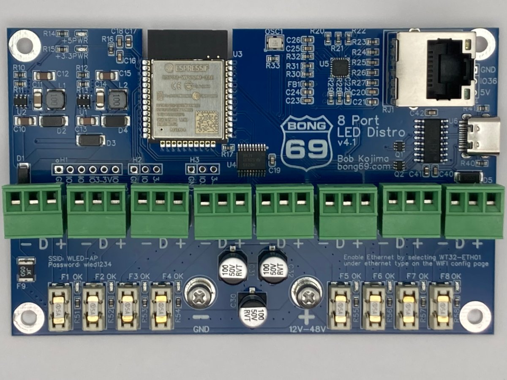
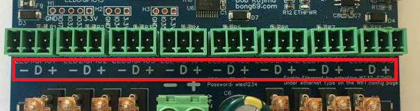
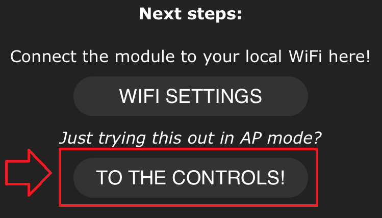
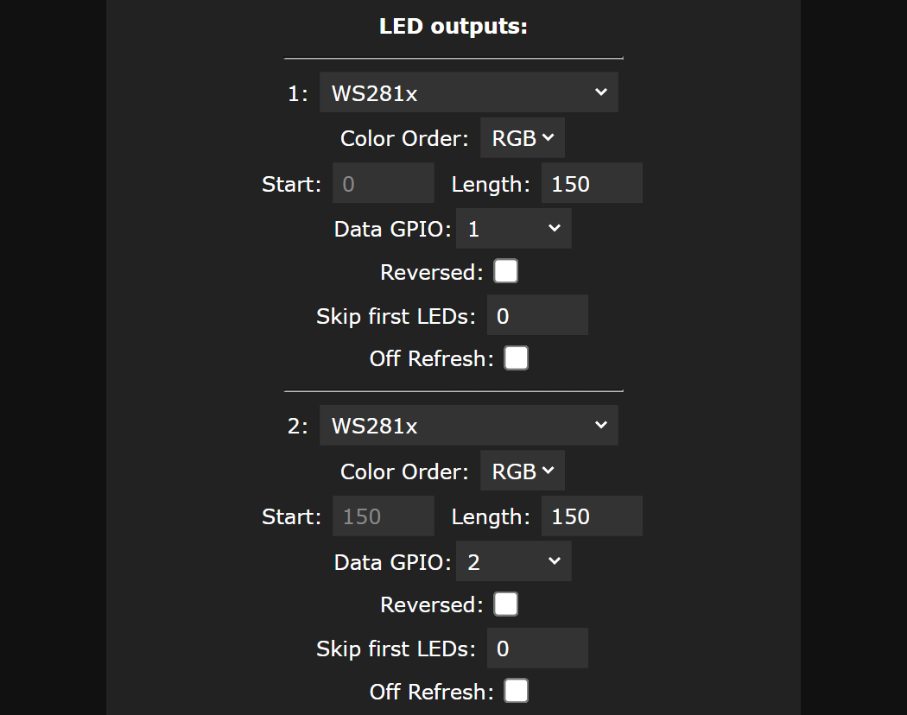

# 8 Port LED Distro

The 8 Port LED Distro is an ESP32 pixel controller that runs WLED and sends both power and data to 8 LED strings from one board.

- **[Quick start guide](#quick-start-guide)**: power up, connect your lights, and see them light up
- **[Network setup](./NETWORK.md)**: Wi-Fi, Ethernet, static IP addresses, finding the board on your network
- **[FAQ](./FAQ.md)**: wiring, power, fuses, GPIO pins, WLED setup, xLights, firmware updates, add-ons
- **[Troubleshooting](./TROUBLESHOOTING.md)**: flicker, ports that won't work, can't find the board
- **[Board versions](./BOARD_VERSIONS.md)**: what changed in each version, dimensions, full pin tables for older boards

## What is it?
- 8 LED outputs, each with power, data and ground on one connector
- Works with **12 V to 48 V pixels**, including 36 V pixels like Govee and 48 V pixels like JellyFish
- A **5 A replaceable fuse** on every output, with a light that shows the fuse is good
- Runs **WLED** out of the box; ESPixelStick also works
- **Wi-Fi or wired Ethernet** (WT32-ETH01), so it works with xLights
- **USB-C** for loading firmware
- Headers for a microphone (sound reactive WLED), a relay, buttons and a temperature sensor

## Specifications (Version 4)
| | |
| --- | --- |
| Pixel voltage | 12 V to 48 V. The power supply voltage must match your pixels. |
| Power input | Round nuts for spade connectors, rated 40 A, with reverse-polarity protection |
| Outputs | 8, each with a 5 A fuse (1808 size) in a fuse holder |
| Data outputs | 5 V, from 74AHCT245 level shifters, with a 33 Ω resistor on each output |
| Data cable to first pixel | 30 ft runs work in our own display without a data booster |
| Network | Wi-Fi or 10/100 Ethernet |
| Firmware | WLED (ships installed and set up), or ESPixelStick |
| Board size | 110 mm × 70 mm × 25 mm |

## Where can I get one?
You can buy the 8 Port LED Distro in our [Tindie store](https://www.tindie.com/products/27884/) and at [Wasatch Lights](https://wasatchlights.com/products/bong-69-controller-priority-shipping-included).

## Which version should I get?
Version 4 is the one we make now. It works with 12 V, 24 V, 36 V and 48 V pixels and handles the higher voltages better. Version 3 (5 V to 24 V) is no longer made, so for 5 V pixels you'll need a different controller. See [Board versions](./BOARD_VERSIONS.md) for what changed in each version.

## What else do I need?
- **Pixels**: any single-wire pixels that WLED supports, such as WS2811, WS2812, WS2815, SK6812 (RGBW) or SM16825 (RGBCCT). Pixels that need a separate clock wire (like APA102 or WS2801) won't work, because each port has one data line.
- **A power supply** with the same voltage as your pixels, big enough for all of them. See [What power supply do I need?](./FAQ.md#what-power-supply-do-i-need)
- **Spade connectors** for the power input wires
- **A phone or computer** to set it up, and an **Ethernet cable** if you'll use Ethernet

## Quick start guide
1. **Connect power.** The power input is the two screw posts in the middle of the bottom edge. Put spade connectors on your power supply wires and fasten them on: ground to **GND (-)** on the left, positive to **12V-48V (+)** on the right.
   - The power supply voltage must match your pixels: a 12 V supply for 12 V pixels, 24 V for 24 V, and so on.
   - Don't turn on the power supply yet.

2. **Connect your lights.** Each output connector has three terminals: **-** (ground), **d** (data) and **+** (power). Check the markings on the board next to each connector to get them right. You can unplug the connectors to tighten the screws.

   

3. **Double check** all power and LED wires.

4. **Turn on the power supply.** The board ships set up for 50 LEDs on each port, so you should see 50 LEDs light up on every port that has lights on it.

5. **Connect to the board.** On your phone, join the Wi-Fi network **WLED-AP**. The password is **wled1234**.

6. A web page opens after you connect. Press **TO THE CONTROLS**.

   

7. Press **Effects** and try out the effects.

### Next steps
1. **Set the number of LEDs on each port**: Config → LED Preferences, change the **Length** of each output. See [How do I set the LED preferences for each port?](./FAQ.md#how-do-i-set-the-led-preferences-for-each-port)

   

2. **Set up the brightness limiter** so your power supply and fuses aren't overloaded. See [How do I set up the brightness limiter?](./FAQ.md#how-do-i-set-up-the-brightness-limiter)

3. **Connect the board to your network**: your home Wi-Fi, or Ethernet for xLights shows. See [Network setup](./NETWORK.md) for step-by-step instructions.

4. **Add it to xLights** (optional): see [How do I add the 8 Port LED Distro to xLights?](./FAQ.md#how-do-i-add-the-8-port-led-distro-to-xlights)

Once the board is on your Wi-Fi or Ethernet, the WLED-AP network no longer shows up. That's normal; see [I no longer see the WLED-AP](./NETWORK.md#i-no-longer-see-the-wled-ap).

## Where can I get help with WLED?
The board runs WLED, but we don't make WLED and can't answer questions about WLED itself (effects, presets, segments, sound reactive settings, usermods). The WLED community knows it best:
- [WLED documentation](https://kno.wled.ge/): start here
- [WLED Discord](https://discord.com/invite/e2NW9hwPeV): the quickest answers
- [WLED forum](https://wled.discourse.group/)
- [r/WLED on Reddit](https://www.reddit.com/r/WLED/)
- [WLED web installer](https://install.wled.me/): install or update WLED from your browser
- [WLED bug reports](https://github.com/wled/WLED/issues): only for bugs in WLED itself

Questions about the board itself (wiring, ports, fuses, power) are answered in the [FAQ](./FAQ.md). For anything else, send us a message through [bong69.com](https://bong69.com/contact.html) or on Tindie.
