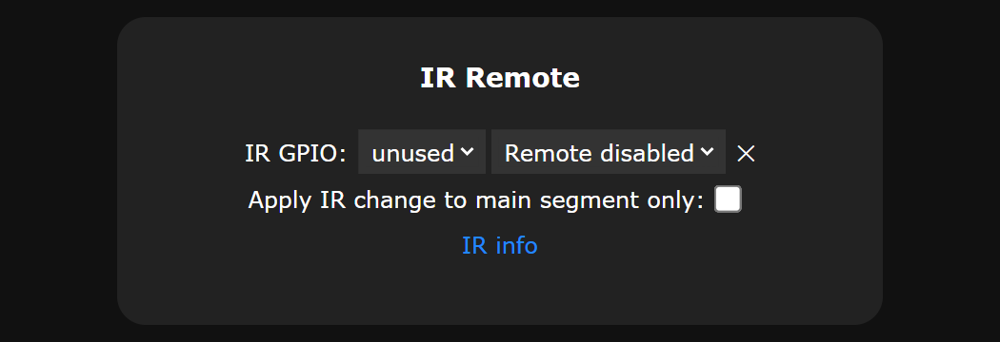
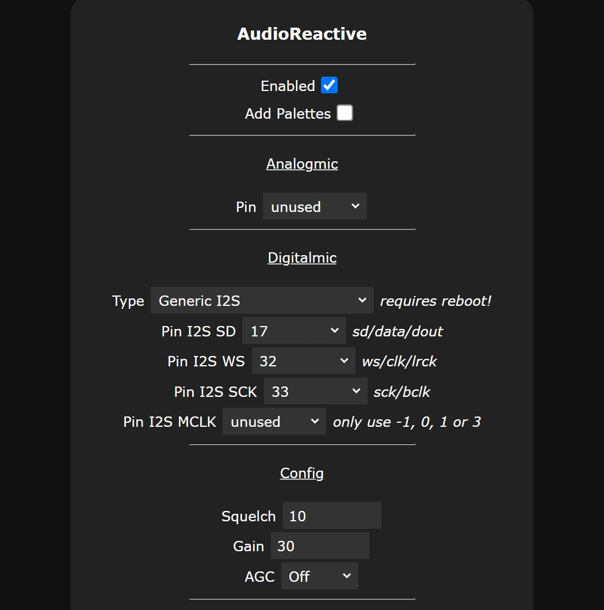
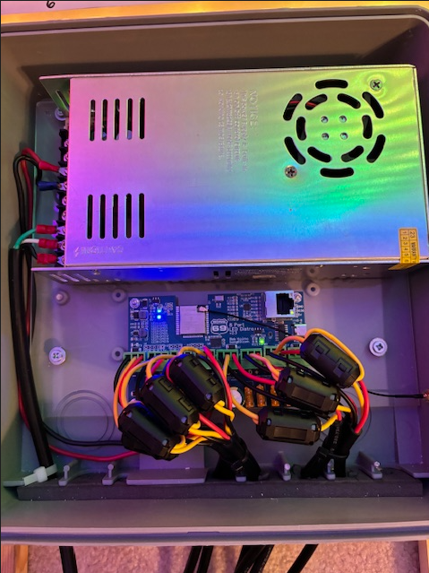

# 8 Port LED Distro Troubleshooting
[Back to the README](./README.md) · [Network setup](./NETWORK.md) · [FAQ](./FAQ.md) · [Board versions](./BOARD_VERSIONS.md)

- [Nothing lights up, not even the lights on the board](#nothing-lights-up-not-even-the-lights-on-the-board)
- [A port doesn't light up](#a-port-doesnt-light-up)
- [WLED won't let me assign a GPIO to a port](#wled-wont-let-me-assign-a-gpio-to-a-port)
- [I see random flickering on some of my LED strings](#i-see-random-flickering-on-some-of-my-led-strings)
- [The colors are wrong](#the-colors-are-wrong)
- [Network problems](#network-problems): Wi-Fi, Ethernet, can't find the board
- [I have Wi-Fi problems after upgrading to WLED 0.15](#i-have-wi-fi-problems-after-upgrading-to-wled-015)
- [WLED doesn't run when USB-C is plugged in](#wled-doesnt-run-when-usb-c-is-plugged-in)
- [Where can I get more help?](#where-can-i-get-more-help)

## Nothing lights up, not even the lights on the board
- Check that the power supply is on, and measure its voltage at the board's power input.
- Check that ground goes to **GND (-)** and positive to **12V-48V (+)**.
- The board's own circuits have a separate small fuse, **F9**, at the bottom left. It's a resettable fuse, so it never needs replacing. If the power supply is fine but the board's power lights stay off, F9 may have tripped:
  1. Turn off the power and wait a few minutes for the fuse to cool down and reset.
  2. Unplug anything connected to the headers (microphone, relay, temperature sensor) and check that wiring for a short.
  3. Turn the power back on.

## A port doesn't light up
- **Check the fuse light** next to that port's fuse. If it's off, the fuse has blown. Find out why (a short, or more than 5 A on that port) before you put in a new one. See [What fuses does it use?](./FAQ.md#what-fuses-does-it-use)
- **Check the wiring** at the output connector: **-** to ground, **d** to data, **+** to power.
- **Check the data direction.** Pixels have an arrow showing which way the data goes. The wire from the board goes to the end the arrow points away from.
- **Check the LED Preferences**: the port needs an output with the right **GPIO**, **LED type** and **Length**. See [What are the GPIO pins for each port?](./FAQ.md#what-are-the-gpio-pins-for-each-port)
- **Ports 4, 7 or 8 only?** See the next question.

## WLED won't let me assign a GPIO to a port
WLED doesn't let two features use the same pin. Newer WLED versions give some of the board's port pins to other features by default.

**Port 4 (GPIO 4), WLED 16.0.0 and later:** GPIO 4 is assigned to the IR sensor.
1. Go to **Config** → **LED Preferences** and scroll down to **IR Remote**.
2. Change **IR GPIO** from `4` to **unused**.

   

3. Scroll to the bottom and press **Save**.
4. Go back to **LED Preferences**, set output 4's **Data GPIO** to **4** and press **Save** again.

**Ports 7 and 8 (GPIO 14 and 15), WLED 0.15 and later:** GPIO 14 and 15 are assigned to the sound reactive microphone.

1. Go to **Config** → **Usermods**.
2. In the **AudioReactive** section, set **Pin I2S SD** to 17, **Pin I2S WS** to 32 and **Pin I2S SCK** to 33. These are the pins the microphone uses on this board anyway.

   
3. Press **Save** and restart the board.
4. Now you can assign GPIO 14 and 15 to ports 7 and 8.

## I see random flickering on some of my LED strings
Flicker can come from many things and can be hard to track down. Check these first:
- **Ground**: the board and every power injection point must share the same power supply and ground. See [How do I do power injection?](./FAQ.md#how-do-i-do-power-injection)
- **Power**: long or dense strings may need more power injection.
- **Connections**: loose or corroded connectors and thin wire add resistance.
- **Data cable**: run the ground wire alongside the data wire. Several runs in our own display have 30 ft of cable to the first pixel and work fine. See [How long can the data cable to the first pixel be?](./FAQ.md#how-long-can-the-data-cable-to-the-first-pixel-be)

If it still flickers, two fixes that have worked for us:
- A **data booster** like an [F-amp](https://pixelcontroller.com/store/accessories/53-famp.html) near the first pixel. Many vendors sell similar items.
- A **ferrite ring** with the data line wrapped around it. [Ferrite example video](https://www.youtube.com/watch?v=6O5rD1BZeVc)

Since Version 3 changed to 33 Ω resistors on the data outputs, we haven't needed F-amps in our own display.

## The colors are wrong
Strips don't all send colors in the same order. In **Config** → **LED Preferences**, change the **Color Order** for that port until red shows as red. Each port has its own setting. Also check that the **LED type** matches your pixels (for example RGB vs RGBW).

## Network problems
Wi-Fi, Ethernet and finding the board on your network are covered on the [Network setup](./NETWORK.md#problems) page.

## I have Wi-Fi problems after upgrading to WLED 0.15
The WLED 0.14 config file doesn't work with 0.15. Load the firmware again with a full erase. See [How do I upgrade from WLED 0.14 to 0.15?](./FAQ.md#how-do-i-upgrade-from-wled-014-to-015)

## WLED doesn't run when USB-C is plugged in
That's normal. Plugging in USB-C puts the board into bootloader mode so you can load firmware, and WLED doesn't run in that mode. Unplug the USB-C cable and power the board from the main power input.

## Where can I get more help?
- **WLED questions** (effects, presets, segments, usermods): see [Where can I get help with WLED?](./README.md#where-can-i-get-help-with-wled)
- **Board questions**: send us a message through [bong69.com](https://bong69.com/contact.html) or on Tindie. Tell us your board version, your pixel type and voltage, how many pixels are on each port, and what you've tried. A photo or short video helps a lot.
